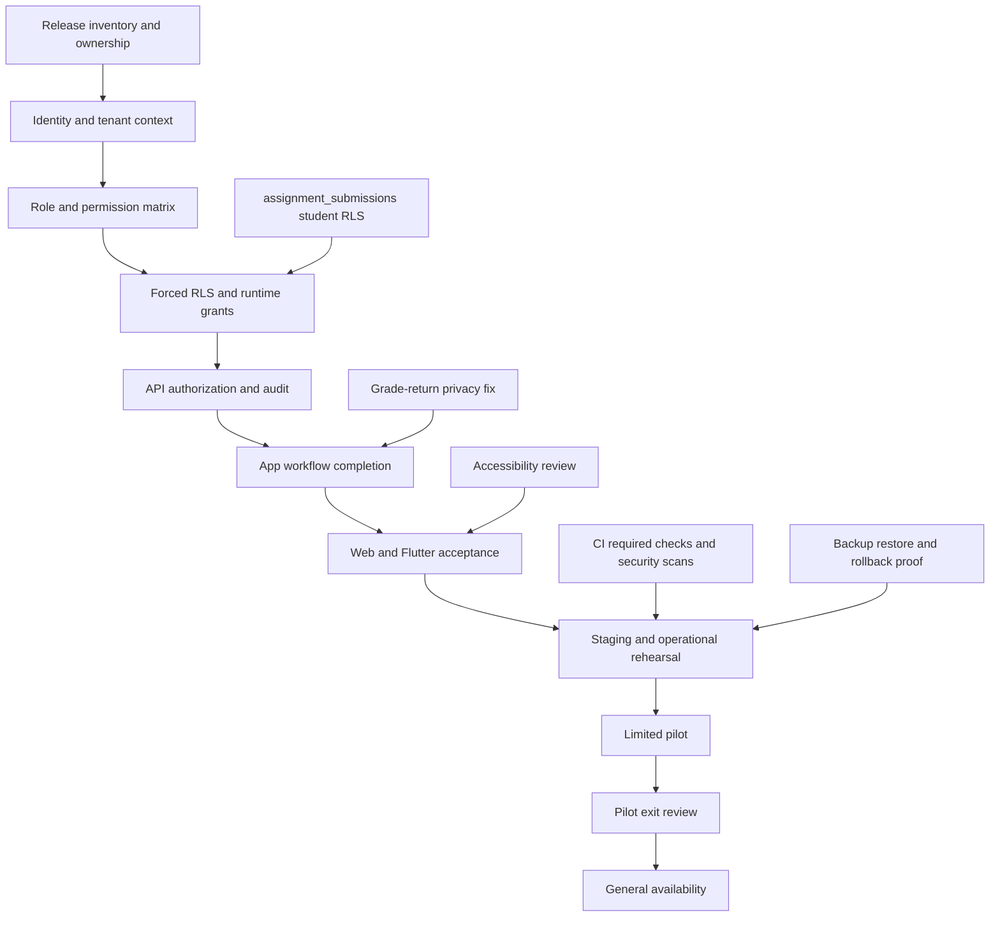

# EduOS App Production Plan

**Plan date:** 2026-11-27  
**Target branch:** `main`  
**Status:** Proposed production program; this document is a plan, not a release certification.  
**Scope:** District, school, homeschool, private-school, federation, web/PWA, Flutter, school-node, and Roku experiences in this repository.

## 1. Production objective

Deliver EduOS as a dependable, secure, supportable school operating system. Every app must be more than a working screen: its workflows, data boundaries, authorization, accessibility, resilience, observability, deployment, support ownership, and recovery procedures must be verified.

Production readiness is earned per app and per capability. A role app may launch in a limited scope while another remains in pilot; do not label the entire platform production-ready based on a successful demo or one passing test suite.

## 2. Non-negotiable product and safety decisions

1. **Tenant and school isolation:** preserve district, school, family, and private-school contexts; enforce authorization on the server and in forced PostgreSQL RLS.
2. **Least privilege:** use a non-owner runtime database role without `BYPASSRLS`; grant only required tables, columns, and functions.
3. **No covert or persistent location tracking:** bus-driver apps do not use GPS or device-location tracking. Keep route/stop sequence and manual stop check-ins. Do not add live bus maps, geofencing, GPS-derived ETAs, route histories, or location-based alerts. Any future proposal would require a separate policy and governance decision; it is not part of this plan.
4. **Safety actions remain human-authorized:** weather alerts may prompt but do not automatically start shelter; SRO workflows do not become police dispatch, CAD/RMS, or 911 integration without separate authority and review.
5. **Nurse boundary:** the current nurse experience is an operational shell, not a clinical health-record product. Do not release clinical charting, medication administration, diagnosis, or treatment workflows until a separately designed Health Office service passes clinical, privacy, legal, and security review.
6. **Family and learner privacy:** guardians see only children for whom they have active authority; students see only information authorized for their role and relationship.
7. **No unapproved external data use:** external AI, messaging, analytics, vendors, and integrations remain disabled or tightly scoped until district approval, privacy review, licensing, and data-flow validation are complete.
8. **No compliance claims by assertion:** document evidence and obtain qualified review; software tests alone do not establish FERPA, COPPA, accessibility, or other legal compliance.

## 3. App portfolio and production tracks

| App / surface | Production outcome | Critical acceptance focus |
|---|---|---|
| Student | Reliable learning, assignments, schedule, grades/progress, library, history and approved activities | Grade visibility/return policy, student-specific RLS, age-appropriate UX, accessible learning flows |
| Parent / guardian | Child-linked progress, schedule, attendance/arrival, transport check-ins, messages, alerts, Time Capsules | Custody/authority changes, child-scoped data, consent and media controls |
| Teacher | Daily operations, classes, assignments, grading, attendance, communications, approved history contributions | Class roster scope, grading permissions, substitute/coverage workflows, media consent |
| Principal / vice principal | School command center, staffing, safety, operations, school oversight | Clear role split, school-only access, approvals, audit trails, escalation and continuity |
| Superintendent / district admin / IT | District governance, configuration, identity, apps, reporting and operations | Separation of duties, district-only authority, no implied student-record access for IT |
| Maintenance / facilities | Work requests, triage, assignment, status, inspections and asset lifecycle as approved | Work-order lifecycle, priority/SLA, evidence, school scope, offline/retry behavior |
| Bus driver / transport | Assigned route and stops, manual rider check-ins, run state, alerts and exceptions | Correct route assignment, safe offline queue, duplicate/replay handling, guardian visibility; **no GPS** |
| SRO / safety | School-scoped safety status and incident assignment/acknowledgement | Active membership, revocation, audit, strict separation from student/discipline/transport records |
| Nurse / health office | Operational coordination only until a separate clinical design is approved | No accidental clinical record exposure; clinical capabilities held behind explicit approval |
| Librarian, counselor, coach, lunchroom, office and other support roles | Complete assigned daily workflows with narrow role access | Role matrix, student relationship scope, accessibility, audit and workflow completion |
| Homeschool hub | Family-directed courses, attendance, work samples, reading, progress and records | Adult authority, family context, clear family-record labeling, safe co-op boundaries |
| Private-school hub | Campus, admissions, classes, attendance, report cards, tuition and communications | School verification, campus isolation, financial dual control, guardian messaging |
| Master Control / federation | Delegated authority, signed policy, jurisdiction, aggregate exchange and node governance | Signed bundles, audit chain, aggregation protections, identity and revocation |
| Web / PWA | Responsive browser and installable mobile web workflows | Browser/device coverage, accessibility, secure sessions, offline boundaries |
| Flutter mobile / desktop | Native role experiences across supported devices | Flutter analyzer/tests, server-address contract, device permissions, upgrade behavior |
| School node / EDEN | Approved school-local continuity and controlled synchronization | Hardware validation, signed identity/bundles, queue integrity, failover/handback and aggregate-only egress |
| Roku | Read-only family Time Capsule viewing | Account/household scope, token lifecycle, no write or expanded disclosure |

## 4. Delivery sequence

### Phase 0 — Establish the release control plane

**Deliverables**
- Publish one production inventory: app, role, platform, owner, maturity, dependencies, known gaps, and release decision.
- Create a release board with one workstream per app and cross-cutting workstreams for identity, data, security, CI/CD, observability, and operations.
- Confirm branch protection and required checks on `main`; every change lands through a reviewed PR.
- Define supported browsers, mobile OS versions, Flutter version, desktop targets, school-node hardware profiles, and Roku support policy.
- Define environments: local development, shared test, staging, pilot, and production. Keep data and secrets isolated.
- Establish release versioning, migration policy, rollback/forward-fix policy, and release notes.

**Exit criteria**
- Every app has a named product owner and technical owner.
- Required CI checks are visible and enforced; failed or skipped checks block release.
- Staging is reproducible from versioned configuration and documented secrets.

### Phase 1 — Security, privacy, and data correctness

**Priority: P0; blocks broad production release.**

1. Close the student grade privacy findings: ensure grades/feedback marked not returned are not exposed to students or guardians, and add student-specific RLS to `assignment_submissions` with real PostgreSQL runtime-role tests.
2. Re-audit every tenant table, join table, attachment, search, export, background worker, and integration for forced RLS and least-privilege grants.
3. Run cross-district, cross-school, cross-family, cross-private-school, stale-session, revoked-guardian, revoked-staff, and IDOR negative tests.
4. Verify permission registry and route middleware alignment; hiding a UI control is not access control.
5. Verify sensitive-read and privileged-write audit events, immutable event history where required, retention, export, correction, deletion, and legal-hold behavior.
6. Validate media scanning, storage authorization, delivery-time consent, consent withdrawal, and signed URL expiry.
7. Review external AI, notification, app catalog, LTI, SIS, webhook, payment, and analytics data flows; default off unless approved.
8. Threat-model safety, pickup, transportation, SRO, school-node, and federation workflows separately.
9. Run dependency, container, source, secret, and CodeQL scans; triage findings with documented severity and disposition.

**Exit criteria**
- All P0 security/privacy defects are fixed and independently reviewed.
- Database enforcement is proven against PostgreSQL as the non-owner runtime role, not mocked or run as table owner.
- No unresolved critical/high findings without an approved, time-bounded risk acceptance.

### Phase 2 — Complete role apps by operational journey

Deliver end-to-end workflows, not isolated screens. Prioritize in this order:

**2A. Student, guardian, and teacher**
- Resolve grade-return and submission RLS defects before releasing Grades broadly.
- Complete student grades/progress and ensure student and guardian views use the same authoritative policy.
- Complete parent child-scoped grades/progress and schedule journeys.
- Complete teacher daily operations, including class day, attendance, grading, messages, coverage/substitute handoff, and consent-aware contributions.
- Validate homeschool/private-school family context and role switching without mixing district and family records.

**2B. School leadership and office**
- Complete principal and vice-principal command workflows, approval boundaries, staffing, escalation, and audit.
- Validate office, arrival, pickup, visitor, and reunification paths with real role/relationship matrices.
- Keep emergency initiation and all-clear human-controlled and drillable.

**2C. Facilities, transport, and SRO**
- Maintenance: add a complete work-order lifecycle, assignment, priority, due dates, inspections, asset references, evidence, and escalation where approved.
- Bus driver: strengthen route assignment, stop sequence, manual rider check-ins, no-show/not-riding, exception reporting, run start/end, vehicle inspection, and dispatch communication. Preserve the no-GPS product rule.
- SRO: validate school membership provisioning/revocation, incident-specific assignment, acknowledge/decline, status transitions, and audit. Keep dispatch and external agency integrations out of scope.

**2D. Other support and specialist roles**
- Audit each librarian, counselor, coach, lunchroom, IT, operations, and office role against the same role matrix and operational acceptance standard.
- Nurse stays operational-only until the separate clinical service approval gate is passed.

**2E. Homeschool, private school, and federation**
- Validate onboarding, authority, campus/family context, learner transfers, consent, billing dual control, district/family boundaries, federation delegation, signed policy bundles, aggregate-only reporting, and revocation.

**Exit criteria for each app**
- All primary workflows have happy-path, denial, edge-case, and recovery tests.
- Product owner signs off against role-specific acceptance criteria.
- No app is marked complete solely because a route or screen exists.

### Phase 3 — Cross-platform quality and resilience

**Web / PWA**
- Run browser smoke and full E2E journeys for each high-priority role.
- Run automated accessibility checks and manual keyboard/screen-reader review for critical journeys.
- Test responsive layouts, supported browsers, session expiry, refresh, file upload/download, and install/update behavior.

**Flutter**
- Run `flutter analyze` and full `flutter test` on the pinned CI Flutter version.
- Test supported iOS/Android/tablet/desktop device profiles, permission prompts, deep links, push handling, app upgrades, and low-connectivity behavior.
- Keep client server-address tests and API contract tests current.

**Offline / EDEN**
- Keep offline data minimized and encrypted; preserve the documented bounded queues.
- Test queue expiry, idempotency, replay, clock skew, duplicate submissions, conflict resolution, and reconnect recovery.
- Test WAN outage, node restart, signed bundle rejection, failover authorization, handback, and purge.
- Verify school-node hardware on the actual supported profile; simulation alone is not hardware certification.

**Roku**
- Test authentication/token lifecycle, household scope, read-only enforcement, playback compatibility, and account revocation.

**Exit criteria**
- Required unit, integration, E2E, edge, Flutter, dependency-security, source/container-security, and Prometheus-rule checks pass.
- Critical user journeys pass on each supported client.
- Offline claims are limited to workflows actually tested.

### Phase 4 — Operational readiness

**Deliverables**
- Dashboards for availability, API latency/error rate, database health, queue depth/age, notification delivery, mobile crash rate, background jobs, node health, and security events.
- Structured logs with correlation IDs and sensitive-data redaction.
- Alerts with severity, owner, runbook, and escalation route; avoid alerts that expose student data.
- Backup schedule, encrypted off-site copies, restore drills, RPO/RTO targets, and documented retention.
- Incident response playbooks for data exposure, account compromise, outage, failed migration, notification failure, lost device, school-node failure, and safety workflow failure.
- Support model: district admin guide, school quick-start guides, staff training, family onboarding, accessibility support, and escalation contacts.
- Data migration/import validation, reconciliation reports, and a rollback/forward-fix decision process.
- Vendor/subprocessor inventory, contracts/DPAs as applicable, data-flow map, and approved integration list.

**Exit criteria**
- Restore and incident exercises have evidence and named participants.
- On-call and district escalation coverage is confirmed for pilot hours.
- Support documentation matches the shipped build.

### Phase 5 — Controlled pilot and general availability

**Pilot sequence**
1. Internal test tenant with synthetic data only.
2. One district/school pilot with named administrators and trained role representatives.
3. Expand to additional schools in the same district after the first pilot exit review.
4. Add homeschool/private-school pilots as a distinct tenant-context track.
5. Expand federation and school-node deployments only after their separate trust, hardware, and recovery gates.
6. General availability only after pilot defects are closed or formally accepted.

**Pilot guardrails**
- Feature flags and district-level enablement for new capabilities.
- No silent migration of live student data; use rehearsed imports and reconciliation.
- Document pilot scope, data, users, success measures, support hours, known limitations, and stop conditions.
- Maintain a tested rollback or disable path for each newly enabled capability.
- Do not enable clinical nurse features, GPS tracking, unapproved external AI, or unapproved third-party data sharing.

**Exit criteria**
- No unresolved P0/P1 defects.
- Pilot success metrics meet thresholds agreed before the pilot.
- District stakeholders sign off on workflows, training, support, privacy, and operational readiness.
- Release notes and known limitations are published.

## 5. Required quality gates

| Gate | Required evidence | Release rule |
|---|---|---|
| Governance | Role/authority decision, data-flow map, privacy review, consent/retention plan | Block if missing |
| Database security | Forced RLS, non-owner runtime role, least-privilege grants, negative isolation tests | Block if missing or failing |
| API security | Auth, authorization, CSRF, validation, rate limits, audit, IDOR tests | Block on critical/high defects |
| Functional | Role journey tests, integration and E2E evidence | Block on critical workflow failure |
| Accessibility | Automated and manual review of critical paths | Block on severe barriers |
| Mobile/client | Analyzer, tests, supported device smoke, permission review | Block on failing required checks |
| Resilience | Retry/replay/offline/recovery tests where applicable | Block if data loss or unsafe duplicate possible |
| Operations | Monitoring, alerting, backup/restore, runbooks, support owner | Block if unowned |
| Release | Reviewed PR, required CI, migration review, release notes, rollback plan | Block if incomplete |

The repository README lists required CI checks: `unit`, `integration`, `e2e`, `edge`, `flutter-mobile`, `dependency-security`, `source-and-container-security`, `prometheus-rules`, and CodeQL. Confirm the branch protection configuration actually enforces them before the first production release.

## 6. Release train and work breakdown

Use small, independently reviewable PRs. Keep each PR on a feature/fix branch created from current `main`; do not mix unrelated app work.

| Workstream | Priority | First deliverable |
|---|---:|---|
| Grade privacy + submission RLS | P0 | Remediation PR and real-Postgres regression suite |
| Production inventory + release checklist | P0 | App ownership and maturity matrix |
| Identity, role and tenant isolation | P0 | Cross-context negative test matrix |
| Deployment / secrets / migrations | P0 | Reproducible staging and rollback runbook |
| Student / guardian / teacher completion | P1 | Role journey acceptance packs |
| Principal / VP / office completion | P1 | Leadership and front-office acceptance packs |
| Transport / facilities / SRO | P1 | No-GPS transport, work-order and SRO acceptance packs |
| Homeschool / private-school | P1 | Separate context onboarding and transfer acceptance |
| Accessibility and device matrix | P1 | Web/Flutter supported-device test plan |
| Monitoring / backup / incident response | P1 | Operational dashboards and restore exercise |
| Federation / EDEN hardware | P2 | Trust and hardware certification |
| Clinical Health Office | HOLD | Separate clinical architecture and approvals |
| GA and scale testing | P2 | Pilot exit report and load/restore evidence |

## 7. Production scorecard

Track these measures weekly and at every release review:

- App readiness: percentage of critical journeys passing per role and platform.
- Security: open P0/P1 findings, RLS/IDOR negative-test pass rate, overdue remediation.
- Reliability: service availability, API p95 latency, error rate, queue age, background job success.
- Client quality: crash-free sessions, failed sign-ins, supported-device smoke pass rate.
- Operations: restore-test success, incident acknowledgement and resolution time, alert noise.
- Adoption: active trained users by role, onboarding completion, support requests per active user.
- Data quality: import reconciliation variance, duplicate/replayed writes, failed sync count.
- Accessibility: unresolved critical barriers in core journeys.

Set numeric SLOs and pilot success thresholds with the district before launch; do not invent targets after observing results.

## 8. Immediate next actions

1. Treat this plan as the master production roadmap and keep it updated through PRs.
2. Finish and review the role-app audit PRs (#229, #230, #231) as evidence inputs; they are audits, not release approvals.
3. Recheck PR #228 and fix the grade-return and student-specific RLS findings before enabling broad student/family Grades release.
4. Create the production inventory and app-owner matrix from the current codebase.
5. Start the P0 security/data-correctness remediation, then proceed through the phases above.
6. Run the full required CI suite and a real staging deployment before any production launch claim.

## 9. Definition of done

EduOS is ready for a production release only when the selected release scope has:
- a named owner and documented supported users/platforms;
- completed primary workflows and role-specific acceptance tests;
- verified tenant, school, family, and private-school isolation;
- passing required CI and real PostgreSQL runtime-role security tests;
- reviewed privacy, consent, retention, accessibility, and integration boundaries;
- tested backup, restore, monitoring, incident response, and rollback;
- completed pilot sign-off and published release notes.

This plan deliberately separates **production planning** from **production certification**. No app or release is certified by this document alone.

---

# Execution Edition — Delivery Control and App Release Contracts

The sections below convert the strategy into a delivery system. They are normative for this production program and take precedence over vague statements such as "finish the app" or "run testing."

## 10. Delivery model: one platform, independently releasable app groups

Do not attempt a single all-app launch. Deliver vertical slices that can be enabled and supported independently while sharing a common security and operations foundation.

### Release waves

| Wave | Release group | Included apps | Why this order | Exit decision |
|---|---|---|---|---|
| 0 — Release foundation | Platform controls | Identity/context, authorization, RLS, audit, deployment, CI, monitoring, backup/restore | Every app depends on these controls | Foundation gate signed |
| 1 — Core school day | Core learning and family | Student, guardian, teacher | Highest daily usage and strongest dependency links | Core-school pilot approved |
| 2 — School command | Leadership and front office | Principal, vice principal, superintendent/district admin, office | Depends on Wave 0 and core school data/workflows | School operations pilot approved |
| 3 — Campus operations | Facilities and transport | Maintenance, bus driver, transport, arrival/pickup | Operationally important; must prove offline and safety boundaries | Operations pilot approved |
| 4 — Safety and specialist | Safety and support | SRO, librarian, counselor, coach, lunchroom, nurse operational shell | Requires especially strict role separation and training | Per-role restricted approval |
| 5 — Alternate education | Non-district contexts | Homeschool, private school | Separate authority, billing, campus/family boundaries | Separate tenant-context pilot |
| 6 — Distributed platform | Federation and local continuity | Master Control, EDEN school nodes, Roku | Requires separate trust, hardware, and recovery proof | Deployment-class certification |

Waves may overlap only when they do not share an unresolved P0 dependency. An app may be marked "pilot-ready" without being GA-ready, but its limitations and feature flags must be explicit.

## 11. Critical dependency graph

**Hard sequencing rules**
- Do not expand the Grades audience until both grade-return visibility and student-level database authorization are fixed and tested.
- Do not treat UI role hiding as a substitute for server authorization or RLS.
- Do not begin a district-wide pilot before staging restore, rollback, alerting, and support escalation have been rehearsed.
- Do not combine district, homeschool, and private-school data contexts in one pilot gate; prove each context independently.
- Do not certify EDEN based only on simulation; require supported hardware evidence.
- Do not add GPS or device-location tracking to bus-driver experiences. The accepted transport model is assigned route/stop sequence plus manual rider check-ins and operational status.

## 12. Work packages and PR sequence

Each package should be a small PR against current `main`, with one accountable owner, a defined acceptance test, and no unrelated refactors. Names below are work-package identifiers, not existing PR numbers.

| ID | Package | Scope / deliverable | Depends on | Priority |
|---|---|---|---|---|
| RP-00 | Production inventory | Enumerate every role app, client surface, owner, maturity, critical journeys, dependencies, open defects, and release state | None | P0 |
| RP-01 | Grade privacy correction | Enforce `returnToStudent:false` consistently in student and guardian API/view paths; regression tests | Current Grades implementation | P0 |
| RP-02 | Submission row security | Student-specific `assignment_submissions` RLS, grants, indexes if needed, real PostgreSQL tests as runtime role | Schema review | P0 |
| RP-03 | Cross-context authorization | Test district/school/family/private-school context switching, revoked roles, stale sessions, IDOR, export and attachments | RP-00 | P0 |
| RP-04 | Release pipeline verification | Confirm required branch protection checks, immutable build artifact, migration ordering, secret injection, release provenance | CI configuration | P0 |
| RP-05 | Staging environment | Reproducible deployment, synthetic seed data, smoke suite, safe reset, isolated secrets | RP-04 | P0 |
| RP-06 | Release observability | Health/readiness, API/database metrics, queue age, notification failures, client crashes, audit/security signals | RP-05 | P0 |
| RP-07 | Backup and recovery | Encrypted backup, restore into isolated environment, data integrity checks, rollback/forward-fix playbook | RP-05 | P0 |
| RP-10 | Student/guardian journeys | Student and parent critical journeys, child-link revocation, grades policy, schedule, attendance and messages | RP-01–03 | P1 |
| RP-11 | Teacher operations | Class day, roster, attendance, grading, communications, coverage, approvals and consent-aware contributions | RP-03 | P1 |
| RP-12 | Leadership and office | Principal/VP authority split, approvals, staffing, arrival, pickup, visitor and reunification journeys | RP-03, RP-06 | P1 |
| RP-13 | Facilities operations | Work order assignment, lifecycle, due dates, inspections, evidence, escalation and audit | RP-03, RP-06 | P1 |
| RP-14 | Driver operations | Route assignment, stop workflow, manual check-ins, offline retry, vehicle checks and exception communications; no GPS | RP-03, RP-07 | P1 |
| RP-15 | SRO access and safety | Membership lifecycle, incident assignment, status/acknowledgement, revocation and negative permission tests | RP-03, RP-06 | P1 |
| RP-16 | Specialist role completion | Librarian, counselor, coach, lunchroom and other staff journeys, each with its own role matrix | RP-03 | P1 |
| RP-17 | Homeschool context | Adult authority, learner profiles, family records, attendance, progress, co-op boundaries and transfer flow | RP-03, RP-05 | P1 |
| RP-18 | Private-school context | School verification, campus boundary, enrollment, attendance, report cards, guardian access and finance dual control | RP-03, RP-05 | P1 |
| RP-19 | Cross-platform acceptance | Web/PWA browser matrix, Flutter device matrix, accessibility and upgrade tests | RP-10–18 | P1 |
| RP-20 | Pilot readiness | Training, support rota, incident rehearsal, district sign-off, success thresholds, rollback switch | RP-06–07, RP-19 | P1 |
| RP-30 | Federation certification | Delegation, signed bundles, aggregate egress, revocation and audit-chain verification | RP-03, RP-06–07 | P2 |
| RP-31 | EDEN hardware certification | Supported hardware, boot/restart, WAN-loss, replay, failover, handback, purge and restore evidence | RP-07, RP-30 | P2 |
| RP-32 | Roku release verification | Household authorization, read-only access, token revocation, device compatibility | RP-03, RP-19 | P2 |
| HOLD-01 | Clinical Health Office | Separate clinical architecture, clinical governance, qualified review, access model and operational safety case | Separate approval | HOLD |

**PR completion rule:** every implementation PR must state the package ID, acceptance criteria, tests run with exact outcomes, tests not run, migration/rollback impact, security/privacy impact, and screenshots or recordings for material UI changes. A green unit suite alone does not satisfy the package.

## 13. App-by-app release contracts

Each app must satisfy the universal gates and its own contract below. "Pass" means evidence is attached to the release record, not merely asserted in a PR description.

### Student app
- Sign in, select the correct school context, navigate core learning, open and submit work, receive teacher feedback, view only returned grades, and handle expired sessions.
- Verify direct API calls cannot reveal unreturned grades, another learner's submissions, private teacher notes, or another school’s records.
- Test accessible navigation, readable status labels, low-bandwidth loading, and supported phone/tablet layouts.
- Blocker: grade-return privacy and student-specific submission RLS findings are closed with real PostgreSQL tests.

### Parent / guardian app
- Link and switch between authorized children; view only the linked child's allowed progress, schedule, attendance, pickup and transport events.
- Revoke or change a guardian relationship and prove access stops immediately, including cached/deep-linked/API paths.
- Test consent withdrawal, media visibility, message recipients, notification redaction and custody/do-not-release restrictions.
- Blocker: any child-scope leakage or stale guardian access.

### Teacher app
- Complete a school day: roster, attendance, assignments, grading, feedback, communications and handoff/coverage.
- Verify teachers cannot access unassigned classes, other schools, private student records, or grades outside their assigned courses.
- Test grade publication/return transitions, accommodations, duplicate submissions, offline-safe operations and media consent.
- Blocker: authorization gaps, grade state inconsistency, or missing audit for sensitive changes.

### Principal / vice principal / superintendent / IT
- Verify the authority matrix for each role and every approval/action, including acting/temporary assignments and revocation.
- Prove school leaders cannot cross school scope unless an explicit district permission allows it.
- Prove IT administration does not imply access to student records.
- Test command-center accuracy, escalation, staffing, emergency status, export and audit history.
- Blocker: role overlap that grants unapproved power or inaccurate operational state.

### Maintenance / facilities
- Submit, triage, assign, start, pause, complete, reopen or cancel work under explicit policy.
- Capture location as a room/building asset reference only where needed; this is not person tracking.
- Test priority, due dates, overdue escalation, duplicate requests, photo evidence scanning, school scope and audit.
- Blocker: lost work orders, untracked state changes, or unauthorized access to another school's facilities records.

### Bus driver / transport
- Driver sees only assigned run/route/stop and minimum rider information required for the assigned trip.
- Record boarding, not-riding/no-show and alighting events with timestamps and safe retry/idempotency.
- Validate run start/end, route reassignment, substitute driver, device offline queue, reconnect replay, and dispatch exception communication.
- Guardian view is limited to their own child's permitted check-in/status; it does not expose a fleet view.
- **GPS prohibition:** no driver GPS permission, background location service, device-location collection, live tracking, geofence, GPS-derived ETA, or location history. Static route/stop instructions and manually reported operational status are acceptable.
- Blocker: any persistent location collection, cross-route rider exposure, or unrecoverable check-in loss.

### SRO / safety
- Provision only after district/school authorization and active school membership; revoke immediately on role/membership end.
- Test incident-specific assignment, acknowledgement/decline, status changes, audit and no-cache behavior.
- Prove SRO cannot query general student records, grades, attendance, pickup, transport or discipline by default.
- No dispatch, CAD/RMS, 911 or automatic police action in this release scope.
- Blocker: broad student access, stale access after revocation, or unreviewed agency integration.

### Nurse / health office
- Release only the current approved operational shell and explicitly documented non-clinical tasks.
- Do not imply clinical charting, diagnosis, medication administration, treatment or medical advice capability.
- Clinical workflows remain a separate hold requiring clinical governance and qualified review.

### Librarian / counselor / coach / lunchroom / office / specialist roles
- Define role-specific allowed actions, records, student relationship scope, retention and sensitive fields.
- Test normal workflow, denied workflow, substitute/temporary assignment, revocation, export and audit.
- No role is approved by copying another role's permissions without review.

### Homeschool hub
- Adult authority and family context are verified before learner access.
- Distinguish family-maintained records from district-issued records and official credentials.
- Test co-op invitation/moderation, adult-only boundaries, consent, learner transfer, export and family dissolution/authority changes.
- Blocker: any cross-family learner disclosure or misleading official-record status.

### Private-school hub
- Verify school and campus membership; isolate campuses and schools according to policy.
- Test admissions/enrollment, attendance, report cards, guardian messaging, transfer acceptance and tuition dual control.
- Ensure one actor cannot unilaterally complete a restricted financial action where dual control is required.
- Blocker: cross-school/campus disclosure, unauthorized guardian access or financial control bypass.

### Master Control / federation / EDEN
- Validate signed identity and policy bundles, authorization expiry, replay protection, revocation and tamper-evident audit.
- Verify aggregate-only egress, minimum cell thresholds and complementary suppression at both egress and hub.
- Prove school-node local workflows and WAN recovery on supported hardware; simulation evidence is labeled simulation.
- Blocker: identifiable student egress outside approved transfer process, invalid signature acceptance, or untested failover.

### Web / PWA / Flutter / Roku
- Web/PWA: supported browser matrix, keyboard and screen reader, responsive breakpoints, install/update and session behavior.
- Flutter: pinned SDK, analyzer, unit/widget/integration tests, supported device smoke, permissions, deep links, crash reporting and upgrade.
- Roku: read-only authorization, household scope, token expiry/revocation and device compatibility.
- A backend pass does not substitute for client acceptance; a UI pass does not substitute for backend authorization.

## 14. Test evidence standard

For each app, maintain a release evidence bundle containing:

1. **Build identity:** commit SHA, version, build artifact digest, environment and configuration version.
2. **Test report:** exact commands, test counts, pass/fail/skip, duration, logs and linked CI run.
3. **Security evidence:** runtime DB role identity, RLS enabled/forced assertions, cross-tenant and IDOR negative results, dependency/container/source scan results.
4. **Journey evidence:** scripted user journey results for each role, browser/device version and redacted screenshots/video where useful.
5. **Resilience evidence:** offline/retry/replay, backup restore, rollback/forward-fix and provider outage outcomes.
6. **Accessibility evidence:** automated scan plus documented manual keyboard/screen-reader review.
7. **Operations evidence:** dashboard links, alert test, runbook, support owner, escalation and restore record.
8. **Sign-offs:** engineering, security/privacy reviewer, product owner, operations owner and pilot district approver.

Use four explicit evidence labels:
- **Code-reviewed:** source inspected; runtime behavior not yet proven.
- **Automated-tested:** specified automated tests passed in a named environment.
- **Staging-verified:** workflow exercised against deployed staging services and real database.
- **Pilot-validated:** trained users completed the workflow in the approved pilot scope.

Never promote a claim from one evidence level to the next without the corresponding run.

## 15. Release gates and decision authority

| Decision | Required approvers | Must answer |
|---|---|---|
| Design ready | Product owner + engineering lead + security/privacy reviewer | Is the workflow in scope, governed, threat-modeled and testable? |
| Code ready | Engineering reviewer + test owner | Are changes reviewed, tests passing and migrations safe? |
| Staging ready | Release manager + operations owner + security reviewer | Is the exact build deployable, observable, restorable and reversible? |
| Pilot ready | Product owner + district sponsor + support lead + security/privacy reviewer | Are users trained, scope limited, stop conditions and support defined? |
| GA ready | Release manager + accountable product executive + operations/security sign-off | Are all blockers closed, pilot outcomes accepted and recovery proven? |

Any approver may block a release within their area of responsibility. Risk acceptance must identify the risk owner, affected scope, compensating control, expiry date and remediation PR. No risk acceptance may waive tenant isolation, forced RLS, student safety boundaries, the no-GPS driver requirement, or a known critical data-loss defect.

## 16. Pilot design and quantitative decision rules

Before inviting pilot users, record baseline and target values. Do not invent success thresholds after the pilot begins.

**Pilot cohort**
- One district/school with an executive sponsor, principal, teacher, office staff, transport representative, family representative and technical administrator.
- Synthetic data in pre-pilot rehearsal; approved minimum live data in the actual pilot.
- Separate homeschool and private-school cohorts with their own authority and data-boundary validation.
- Named support coverage during every pilot operating window.

**Minimum measures**
- Critical journey completion rate by role.
- Failed/duplicate/lost writes and offline queue recovery.
- Authentication and authorization failures, including denied cross-scope probes.
- API availability, latency and error rate under pilot load.
- Mobile crash-free sessions and supported-device defects.
- Notification delivery and stale/incorrect notification rate.
- Support tickets per active user and time to resolve.
- Accessibility blockers and task completion with assistive technology.
- Data import reconciliation variance and unresolved record mismatches.

**Automatic stop conditions**
- Confirmed cross-tenant, cross-school, cross-family or unauthorized guardian disclosure.
- Grade or sensitive record exposed before authorized release.
- Lost or duplicated safety/transport event that changes an operational decision.
- RLS or authorization bypass, compromised signing key, or invalid federation bundle accepted.
- Unrecoverable data loss, failed restore, or inability to roll back/disable the release.
- No staffed incident response during the pilot window.

A stop condition pauses the affected feature or pilot immediately, preserves evidence, triggers the incident playbook and requires a documented restart decision.

## 17. Delivery cadence and management rhythm

Use a two-week planning/review rhythm as a default, not as a promise of completion dates:

- **Start of cycle:** select a small set of PR work packages whose dependencies are clear; assign one directly responsible owner per package.
- **Daily:** review blocked PRs, CI failures, production-impacting defects and dependency changes.
- **Mid-cycle:** demonstrate completed user journeys on a deployed environment, not slides or isolated screens.
- **End of cycle:** review merged code, exact test evidence, unresolved risks, updated app readiness states and next-cycle dependencies.
- **Before every release:** run the go/no-go meeting against the gates in Section 15 and attach the evidence bundle.

### Required weekly report

| Field | Required content |
|---|---|
| App / work package | Exact role app and RP/HOLD identifier |
| State | Not started / in progress / blocked / code-reviewed / automated-tested / staging-verified / pilot-validated / GA |
| This cycle | Merged PRs and completed user journeys |
| Next | One concrete next deliverable |
| Blockers | Defect, dependency, owner and decision needed |
| Evidence | CI run, staging result, security test and review links |
| Risk | Severity, scope, mitigation, expiry or stop condition |

### Current baseline and immediate execution order

At plan creation, the repository inventory shows:
- PR #228 is the Student Grades implementation and contains known grade-return privacy and student-specific submission RLS findings that must be rechecked before broad release.
- PRs #229, #230 and #231 are role-app audit documents. They are evidence inputs, not app-completion work and not release approvals.
- The repository README documents required CI checks and the governance baseline; actual branch-protection enforcement and a full production staging rehearsal still need explicit verification.
- The transport product rule is no GPS/location tracking for bus drivers.

**Next executable sequence**
1. Recheck PR #228 against current `main`; split the grade-return behavior and RLS remediation if they are not already addressed.
2. Create RP-00 inventory from the current code and the three audit documents; classify each app as code-reviewed, automated-tested, staging-verified, pilot-validated or GA.
3. Implement RP-01 and RP-02 as separate, reviewable P0 PRs with real PostgreSQL runtime-role tests.
4. Verify required CI branch protection, then establish staging, restore, monitoring and rollback evidence (RP-04 through RP-07).
5. Start Wave 1 student/guardian/teacher acceptance; do not start broad Wave 1 pilot until the P0 gates pass.
6. Run subsequent app waves using the app contracts in Section 13 and record each release decision.

**This execution edition does not claim that any app has passed these gates.** It defines the work and the evidence required to make that determination.
